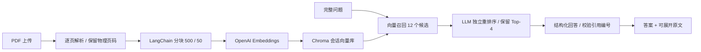

# 知页 Pagewise · 基于 RAG 的智能学习助手

面向长篇 PDF 教材的知识点定位与复习。上传教材，用自然语言提问，展开引用查看原文及 PDF 页码。

**Python · Streamlit · LangChain · OpenAI API · Chroma**

## 快速运行

需要 Python 3.11–3.13（本项目使用 Python 3.12 验证）。

```bash
python -m venv .venv
# macOS / Linux
source .venv/bin/activate
# Windows PowerShell: .venv\Scripts\Activate.ps1
# 可复现完整测试环境：pip install -r requirements-lock.txt
pip install -r requirements.txt
streamlit run app.py
```

浏览器打开 http://localhost:8501 。选择「离线演示」→ 勾选示例教材 →「建立 / 更新知识库」→ 提问：

- 事务的 ACID 特性分别是什么？
- 主键和外键有什么区别？
- 索引有什么优缺点？

离线演示不需要密钥，使用确定性的词汇哈希向量 + BM25 重排序，仅摘录原文，**不是模型语义问答**。

## 使用真实 OpenAI RAG

1. 切换「OpenAI 问答」，在侧栏输入自己的 OpenAI API Key。
2. 默认回答 / 重排序模型为 `gpt-4.1-mini`，Embedding 为 `text-embedding-3-small`；均可按账户可用模型修改。回答模型需要支持结构化输出。
3. 上传 PDF，勾选允许教材文本发送至 OpenAI，再建立知识库。
4. 提问后展开 `[1]`、`[2]` 等证据，核对文件名、页码和原文。

也可以复制 `.env.example` 为 `.env` 并填写环境变量。不要提交 `.env` 或密钥。公共部署建议访客自带密钥，不要配置共享付费密钥。

## 实现链路



- **分块**：RecursiveCharacterTextSplitter；以字符计数，默认 `chunk_size=500`、`chunk_overlap=50`，按页分块，避免页码混淆。
- **召回与重排序分离**：先向量召回 `fetch_k` 个片段，再由 LLM 按相关性重排，保留 `top_k`。演示模式第二阶段使用 BM25。
- **引用**：为检索片段分配编号；模型输出事实及证据编号，服务端校验编号范围并附上引用。未知引用 / 无引用时拒绝输出答案。编号校验不代表事实自动得到证明，仍需核对原文。
- **不足即拒答**：重排序返回空证据、生成返回空事实时提示证据不足。
- **会话隔离**：每个知识库使用随机独立 Chroma collection；更换教材、分块、模式或模型时清空旧结果；清空按钮删除 collection。默认不持久保存索引。
- **长文档**：Embedding 分批提交，避免整本教材单请求。限制单文件 30 MB、600 页、200 万提取字符。
- **单轮检索**：聊天界面展示历史，每个问题独立检索，需提供完整问题，不自动解析“它”等指代。

## 隐私与局限

- 离线模式不向模型服务发送教材；OpenAI 模式会将分块文本、问题及候选片段发送给 OpenAI，并产生 API 费用。
- 上传文件、向量和会话数据由运行应用的服务端处理。索引仅在进程中保存，点击清空会删除当前 collection；浏览器断开后进程可能继续保留会话一段时间，进程重启后清除。不要在不信任的公共服务上传敏感教材或密钥。
- 支持可提取文本的 PDF；扫描件需要先 OCR，加密 PDF 需先解除密码。混合扫描 / 文本 PDF 可能缺少扫描页内容；复杂表格和公式可能提取失真。
- 页码是从 1 开始的 PDF 物理页序号，可能与书内印刷页码不同。
- Prompt 明确将教材作为不可信资料处理，但不能保证完全消除提示注入和幻觉；本项目没有工具执行权限。
- 没有声称 400 页性能、检索准确率提升、真实用户数量或上线指标；需用实际教材与标注问题另行评估。

## 测试

```bash
pip install -r requirements-dev.txt
ruff check .
pytest -q
```

覆盖真实中文 PDF 解析、分块页码、Chroma 检索、BM25、会话隔离、异常文件、结构化模型接口、引用拒绝、Streamlit 建库 / 提问 / 切换模式。模型测试使用 mock，不消耗 API 额度。

## 部署与分享

GitHub 保存源码，不能直接执行 Python RAG 后端。可以选择：

- **Streamlit Community Cloud**：连接此 GitHub 仓库，入口 `app.py`，选择支持的 Python 版本并部署；访客可用离线演示或自带 Key。
- **Docker**：

```bash
docker build -t pagewise .
docker run --rm -p 8501:8501 pagewise
```

公共环境请按实际需要增加认证、配额、上传限制与资源回收；本项目是可运行的个人学习项目，不宣称具备多租户生产服务保障。

## 目录

```text
app.py                    Streamlit 界面与会话控制
study_assistant/core.py   PDF / 分块 / 向量库 / 重排序 / 引用
samples/                  原创数据库复习材料与生成脚本
tests/                    核心流程及界面测试
.github/workflows/ci.yml  GitHub Actions 检查
Dockerfile                容器运行入口
```

技术文档：[OpenAI Embeddings](https://developers.openai.com/api/docs/guides/embeddings)、[LangChain Chroma](https://docs.langchain.com/oss/python/integrations/vectorstores/chroma)、[Streamlit](https://docs.streamlit.io/)。

MIT License。示例教材为本项目原创演示材料。
